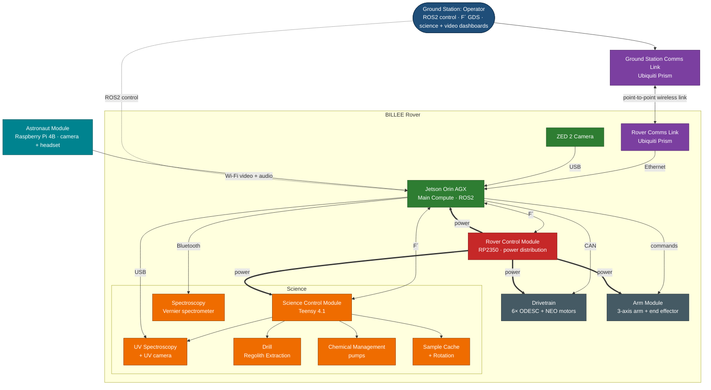
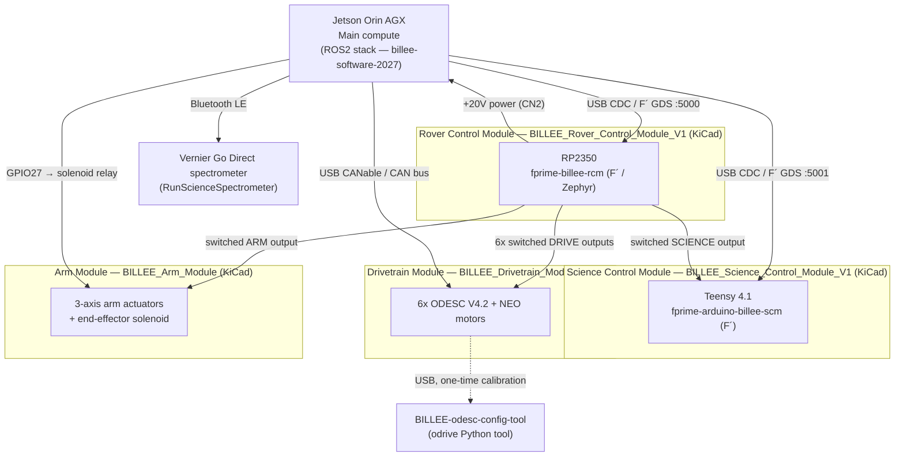
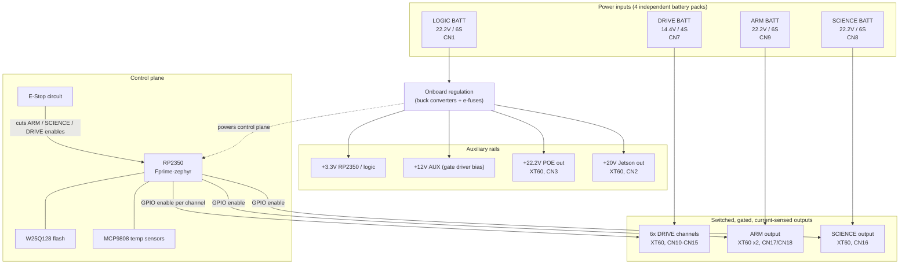
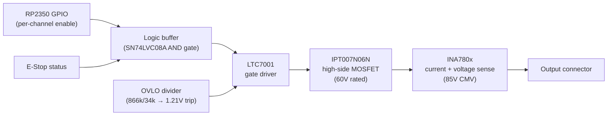
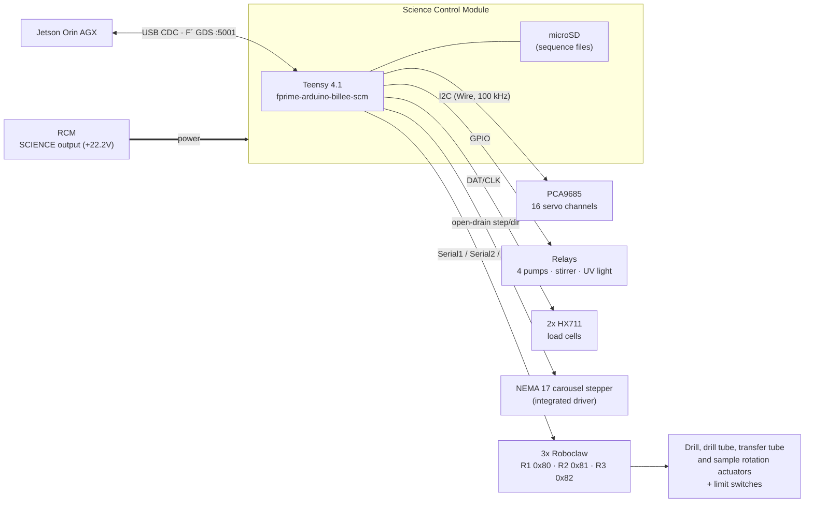

# BILLEE Hardware 2027
### By Luca Lanzillotta

This repository contains the hardware design and simulation files for the BILLEE Rover Control Module, the Science Control Module hardware and its F´ firmware, the RCM's F´/Zephyr firmware, wiring schematics for the drivetrain, arm and astronaut modules, and all supporting resources required to operate BILLEE for URC 2027.
If you are looking for our ROS2 Humble Software Stack, refer to [billee-software-2027](https://github.com/BroncoSpace-BILLEE/URC-2027).

## Table of contents

- [Rover architecture](#rover-architecture)
- [Repository layout](#repository-layout)
- [System architecture](#system-architecture)
- [BILLEE Rover Control Module PCB](#billee-rover-control-module-pcb)
  - [System overview](#system-overview)
  - [Power architecture](#power-architecture)
  - [Per-channel protection chain](#per-channel-protection-chain)
  - [Subsystems](#subsystems)
  - [Connectors](#connectors)
  - [RCM Firmware](#rcm-firmware)
- [BILLEE Science Control Module](#billee-science-control-module)
  - [Science hardware](#science-hardware)
  - [SCM Firmware](#scm-firmware)
- [BILLEE Drivetrain Module Schematic](#billee-drivetrain-module-schematic)
- [BILLEE Arm Module Schematic](#billee-arm-module-schematic)
- [BILLEE Astronaut Module Schematic](#billee-astronaut-module-schematic)
- [Drivetrain motor calibration — ODESC Configuration](#drivetrain-motor-calibration--odesc-configuration)
- [Science spectrometer tooling](#science-spectrometer-tooling)
- [Astronaut video/audio streamer](#astronaut-videoaudio-streamer)
- [UV science camera](#uv-science-camera)
- [Battery charger control (ISDT Air8)](#battery-charger-control-isdt-air8)
- [Robot model builder (Blender)](#robot-model-builder-blender)
- [Getting started](#getting-started)
- [Design status](#design-status)
- [Contributors](#contributors)

## Rover architecture

A full-system view of BILLEE, from the operator at the ground station down to
each subsystem on the rover. Every link from the ground station to the rover
goes over the Ubiquiti Prism point-to-point link to the Jetson. The Jetson
then reaches the RCM and SCM over F´, the drivetrain over CAN, the arm over
GPIO, and the science instruments and astronaut module over USB, Bluetooth LE
and Wi-Fi. Thick arrows are power from the RCM, normal arrows are data, and the
dashed arrow is ROS2 control from the ground station.



The [System architecture](#system-architecture) section below zooms in on
the boards in this repo and how they connect.

## Repository layout

```
billee-hardware-2027/
├── BILLEE_Arm_Module/                    # KiCad project for the Arm Schematic
├── BILLEE_Astronaut_Module/              # KiCad project for the Astronaut Module Schematic
│   └── AstronautModuleAssembly/          # SolidWorks assembly: Raspberry Pi 4 mount + lid, Pi 4 datasheet
├── BILLEE_Drivetrain_Module/             # KiCad schematic documenting the drivetrain wiring (ODESC + NEO + CAN)
├── BILLEE_Rover_Control_Module_V1/       # KiCad project for the Rover Control Module
├── BILLEE_Science_Control_Module_V1/     # KiCad project for the Science Control Module (sheet per science subsystem)
├── BILLEE-air8-charger-tool/             # Web UI + Python BLE backend to run the ISDT Air8 charger (git submodule)
├── BILLEE-creation-toolkit/              # Blender extension: build the rover and arm, export ROS 2 + MoveIt packages (git submodule)
├── BILLEE-odesc-config-tool/             # Python tool: USB ODESC motor calibration
├── RunScienceSpectrometer/               # Offline Vernier spectrometer PWA + kiosk setup for the Jetson (git submodule)
├── astronaut-streamer/                   # Pi camera → Jetson → ground-station video + audio stream (git submodule)
├── fprime-billee-rcm/                    # F´ firmware for the RCM board (git submodule)
├── fprime-arduino-billee-scm/            # F´ firmware for the Science Control Module (git submodule)
├── uv_scienceCam/                        # USB Arducam → browser stream with live image tuning + snapshots (git submodule)
└── Makefile                              # Workspace bootstrap (`make setup`/`make rover`) + science/astronaut installers
```

## System architecture

BILLEE's compute and control hardware breaks down into a Jetson Orin AGX main
compute module, the Rover Control Module (RCM, this repo's primary board),
the Science Control Module (SCM), and the drivetrain's ODESC motor
controllers. The RCM both powers the Jetson and exchanges F´ telemetry/
commands with it; the SCM and the Jetson each run their own F´ deployment,
talking over separate USB connections and separate GDS dashboard ports so
both can be open at once.



Solid arrows are runtime power/data paths; the dashed arrow is the ODESC
calibration tool's occasional USB connection, not part of the running
topology. Runtime drivetrain/arm motor commands come from the ROS2 stack in
[billee-software-2027](https://github.com/BroncoSpace-BILLEE/URC-2027), outside
this repo's scope — the RCM only switches and protects their power.

### Hardware ↔ Firmware

| Hardware (KiCad project) | Firmware | Target | Role |
|---|---|---|---|
| [`BILLEE_Rover_Control_Module_V1/`](BILLEE_Rover_Control_Module_V1/) | [`fprime-billee-rcm`](fprime-billee-rcm/README.md) | RP2350 (F´ / Zephyr) | Power distribution/gating for DRIVE, ARM, and SCIENCE; powers the Jetson; reports subsystem/E-Stop/thermal telemetry over USB |
| [`BILLEE_Science_Control_Module_V1/`](BILLEE_Science_Control_Module_V1/) | [`fprime-arduino-billee-scm`](fprime-arduino-billee-scm/README.md) | Teensy 4.1 (F´) | Runs the science payload: drill and actuator motors (3 Roboclaws), 16 servos, pumps, stirrer and UV light relays, load cells, and the sample carousel stepper; USB CDC to Jetson |
| [`BILLEE_Arm_Module/`](BILLEE_Arm_Module/) — arm wiring (off-the-shelf actuators, documented here) | — | — | Arm axis actuators and end-effector solenoid, powered from the RCM's switched ARM output |
| [`BILLEE_Drivetrain_Module/`](BILLEE_Drivetrain_Module/) — ODESC motor controllers (third-party hardware, wiring documented here) | [`BILLEE-odesc-config-tool`](BILLEE-odesc-config-tool/README.md) | ODrive-based ODESC | One-time/occasional USB calibration tool (encoder/motor cal, CAN node ID) — not runtime firmware |

BILLEE is a Mars-rover-style rover platform built as a university project. This repository holds the hardware for the **Rover Control Module (RCM)** — the rover's central power distribution and control board. It takes in power from up to four independent battery packs, gates and protects eight switched high-current outputs (six drivetrain channels plus dedicated ARM and SCIENCE subsystem outputs), and hosts the RP2350 microcontroller that supervises the whole board, running [NASA JPL's F´ (F Prime)](https://fprime.jpl.nasa.gov/) flight software framework on Zephyr RTOS.

## BILLEE Rover Control Module PCB


## System overview



## Power architecture

Every high-current output is switched, not just fused — each channel has its own MOSFET high-side switch, gate driver, and current/voltage sense IC, controlled by the RP2350 and independently protected against overvoltage.

| Input | Voltage | Pack | Connector | Feeds |
|---|---|---|---|---|
| LOGIC | 22.2V nominal | 6S | CN1 (XT90) | Onboard regulation → 3.3V logic, 12V gate-driver bias, POE out, Jetson out |
| DRIVE | 14.4V nominal | 4S | CN7 (XT90) | 6x independently gated drivetrain outputs |
| ARM | 22.2V nominal | 6S | CN9 (XT90) | ARM actuator output (dedicated, not shared with LOGIC) |
| SCIENCE | 22.2V nominal | 6S | CN8 (XT90) | SCIENCE payload output (dedicated, not shared with LOGIC) |

ARM and SCIENCE each have their own battery input rather than sharing the LOGIC bus — this keeps their (higher-current, motor-driven) load switching electrically isolated from the board's own logic supply.

## Per-channel protection chain

The same signal chain protects all eight switched outputs (six DRIVE channels, ARM, SCIENCE) — this is what sits between the RP2350's enable GPIO and the actual output connector:



Each channel's overvoltage lockout trips at roughly the same ~32V threshold regardless of that channel's nominal rail — set by a fixed 866kΩ/34kΩ divider into the gate driver's 1.21V comparator reference. The MOSFETs and current-sense amplifiers were selected with wide margin above every rail on this board (60V and 85V ratings against a top end around 25V), so the same switch/sense stage is reused across the 14.4V DRIVE channels and the 22.2V ARM/SCIENCE channels without modification.

## Subsystems

| Subsystem | Sheet | What's there |
|---|---|---|
| RP2350A | `mcurp2350.kicad_sch` | RP2350 MCU, crystal, QSPI flash, USB-C, SWD debug header, GPIO breakout |
| Logic Subsystem | `power.kicad_sch` | Buck regulators, e-fuses, logic/auxiliary rail generation |
| Subsystem Power Control | `estop.kicad_sch` | E-stop circuit, all 8 gate-driver/switch/sense channels, OVLO dividers |

## Connectors

| Ref | Part | Count | Purpose |
|---|---|---|---|
| CN1 | XT90PW | 1 | LOGIC battery input (22.2V) |
| CN7 | XT90PW | 1 | DRIVE battery input (14.4V) |
| CN8 | XT90PW | 1 | SCIENCE battery input (22.2V) |
| CN9 | XT90PW | 1 | ARM battery input (22.2V) |
| CN10–CN15 | XT60PW | 6 | DRIVE channel outputs 1–6 |
| CN16 | XT60PW | 1 | SCIENCE output |
| CN17, CN18 | XT60PW | 2 | ARM output |
| CN2 | XT60PW | 1 | Jetson power output (+20V) |
| CN3 | XT60PW | 1 | POE output (+22.2V) |
| CN4, CN5 | XT60PW | 2 | Auxiliary +12V outputs |
| CN6 | DF11-18DP | 1 | RP2350 GPIO breakout (9 GPIO + ADC0/1 + power/GND) |
| USB1 | USB-C | 1 | RP2350 USB |
| J1 | 2.54mm header | 1 | SWD debug (SWCLK/SWD/GND) |

## RCM Firmware

The RCM's RP2350 runs [F´](https://fprime.jpl.nasa.gov/) (v4.2.2) on Zephyr
RTOS (v4.3.0) and talks to the Jetson over USB CDC, carrying F´ CCSDS frames.
Its project components are:

| Component | What it does |
|---|---|
| `subsystemManager` | Turns DRIVETRAIN, ARM and SCIENCE power on and off; enforces E-STOP |
| `mcpManager` | MCP9808 board temperatures, with tunable warning/fault thresholds |
| `inaManager` | INA780B bus voltage and current on every switched channel |
| `fpManager` | Software fault protection: overcurrent, over/undervoltage and over-temperature |

How it behaves:

- **All eight power enables are driven LOW at early boot**, before USB comes
  up, so no output turns on by itself.
- **E-STOP**: the hardware AND gates cut every channel at once. The firmware
  polls the line at 10 Hz, forces any ON subsystem OFF in software, and rejects
  power-ON commands while it is engaged. Releasing it turns nothing back on.
- **Faults latch.** A tripped DRIVETRAIN, ARM or SCIENCE fault forces that
  subsystem OFF until `fpManager.CLEAR_FAULT`. One wheel faulting shuts off the
  whole drivetrain. A LOGIC fault only raises an alert, since LOGIC powers the
  RP2350 itself.
- **Rate groups**: E-STOP, subsystem control and INA polling run at 10 Hz;
  telemetry and housekeeping at 1 Hz.

To get started:

```bash
cd fprime-billee-rcm
make setup           # creates fprime-venv, inits submodules, installs requirements.txt
make setup-zephyr    # Zephyr + SDK (slow, one-time)
make build-rp2350    # builds build-artifacts/zephyr.uf2
```

On the Jetson, `make install-gds-service` runs the GDS at every boot in a
detached `screen` session (dashboard on port **5000**), and a udev rule gives
the board a stable `/dev/ttyBILLEE_RCM` name so it never swaps places with the
SCM.

See [`fprime-billee-rcm/README.md`](fprime-billee-rcm/README.md) for flashing
on macOS, WSL2 and Linux, and
[`docs/OPERATOR_MANUAL.md`](fprime-billee-rcm/docs/OPERATOR_MANUAL.md) for the
command/telemetry reference and the power-on checklist.

## BILLEE Science Control Module

The Science Control Module (SCM) runs the science payload. A Teensy 4.1
drives every motor, servo, pump and sensor on it, takes its power from the
RCM's switched `SCIENCE` output, and reports to the Jetson over USB. The
spectrometer and UV camera are the exceptions: they connect to the Jetson
directly (see [Science spectrometer tooling](#science-spectrometer-tooling) and
[UV science camera](#uv-science-camera)).

[`BILLEE_Science_Control_Module_V1/`](BILLEE_Science_Control_Module_V1/) is
the KiCad project. Its top sheet has one sheet per subsystem: Science Control
Module, Regolith Extraction Module, Sample Cache and Rotation System, Chemical
Management System, and UV Spectroscopy Module. Pin-level wiring is in
[`fprime-arduino-billee-scm/PinTable.md`](fprime-arduino-billee-scm/PinTable.md),
which follows the Science Hardware Architecture 2027 block diagram.

### Science hardware



| Hardware | Connection to the Teensy | Firmware component |
|---|---|---|
| Roboclaw R1 (`0x80`): soil drill actuator (M1), transfer tube actuator (M2) | `Serial1` (pins 1/0), 38400 baud; limit switches 23/22 and 21/15 | `roboclawManager` |
| Roboclaw R2 (`0x81`): transfer tube lead screw (M1), drill (M2) | `Serial2` (pins 8/7); M1 limit switches 14/41, the drill has none | `roboclawManager` |
| Roboclaw R3 (`0x82`): sample rotation linear actuator (M1) | `Serial4` (pins 17/16); limit switches 33/32 | `roboclawManager` |
| PCA9685 servo board, `S1`–`S16` (S1 cup tilt, S2 drape, S3 cache lid, S4 funnel flap) | I2C `Wire` (18 SDA / 19 SCL), address `0x40` | `pca9685Manager` |
| Pump 1–4 relays (+12V) | GPIO 39, 38, 37, 36 | `relayManager` |
| Magnetic stirrer relay (+12V) | GPIO 34 | `relayManager` |
| UV light relay (+22.2V) | GPIO 40 | `relayManager` |
| HX711 load cells `CELL1`, `CELL2` | DAT/CLK 24/25 and 26/27 | `loadCellManager` |
| Carousel stepper (NEMA 17, integrated driver) | PU-/DR-/MF- on 2/3/4, open-drain | `stepperManager` |
| microSD (on the Teensy) | SDIO | `fileManager`, `cmdSeq` |

Wiring rules that apply to the whole board (details in the
[pin table](fprime-arduino-billee-scm/PinTable.md#wiring-conventions)):

- **Teensy 4.1 pins are 3.3V and not 5V tolerant.** Power the PCA9685 logic
  and both HX711 boards from the Teensy's 3.3V; servo power goes on the
  PCA9685's separate V+ rail with grounds tied.
- **Limit switches close to GND** when tripped (internal pull-ups, an open
  switch reads HIGH). `FORWARD` always moves a Roboclaw motor toward its upper
  switch, and a motor moving into a tripped switch is stopped within 20 ms.
- **Relays are active HIGH** and every relay pin is driven LOW at boot.
- **Spare pins**: 6, 9–13 (SPI is entirely free), 20 (the only free analog
  input), 28/29 (`Serial7`, the only free UART), 30, 31, 35, and 5 (reserved
  for the stepper).

## SCM Firmware

The SCM runs [F´](https://fprime.jpl.nasa.gov/) (v4.1.1) on the Teensy 4.1
through [fprime-arduino](https://github.com/fprime-community/fprime-arduino).
It talks to the Jetson over its own USB CDC connection, with its GDS on port
**5001** next to the RCM's on port 5000, so both dashboards can be open at
once. A udev rule gives it a stable `/dev/ttyBILLEE_SCM` name.

Each piece of hardware has one component, and every command that waits on
hardware (`RUN_FOR`, `TO_LIMIT`, `ON_FOR`, `WAIT_MASS`, `MOVE_TO`, ...) answers
when it finishes. That lets science procedures run as F´ command sequences
from the SD card. For example, lowering the drill tube to its limit, dosing
pump 1 for 3 s, then waiting for 50 g on load cell 1:

```
R00:00:00 billee_deployment.roboclawManager.TO_LIMIT R2_M1 REVERSE 30 20000
R00:00:00 billee_deployment.relayManager.ON_FOR PUMP1 3000
R00:00:00 billee_deployment.loadCellManager.WAIT_MASS CELL1 ABOVE 50 60000
```

To stop everything: `relayManager.ALL_OFF`, `roboclawManager.STOP_ALL`,
`pca9685Manager.STOP_ALL`, `stepperManager.STOP`, and `cmdSeq.CS_CANCEL` for a
running sequence.

To get started:

```bash
cd fprime-arduino-billee-scm
make setup              # fprime-venv, submodules, Python deps, udev rule
make setup-arduino      # arduino-cli + Teensy core
make setup-flash-tools  # teensy_loader_cli, for headless flashing
make generate && make build
make flash              # build and flash with no button press
make install-gds-service  # on the Jetson: GDS at every boot, port 5001
```

If the board asserts, it reboots into the Teensy bootloader so `make flash`
still reaches it, and `bootReporter` reports where the assert happened on the
next boot. See
[`fprime-arduino-billee-scm/README.md`](fprime-arduino-billee-scm/README.md)
for the full command reference, the sequence workflow, and the RAM and table
limits to check before adding a component.

## BILLEE Drivetrain Module Schematic

[`BILLEE_Drivetrain_Module/`](BILLEE_Drivetrain_Module/) is a KiCad
schematic documenting the drivetrain wiring as built for the '24 URC season:
six ODESC V4.2 controllers, each driving a NEO brushless motor with Hall
feedback, fed from the RCM's six switched `DRIVE` outputs and sharing a CAN
bus that reaches the Jetson through a USB CANable. It's wiring documentation
for the third-party hardware, not a custom PCB.

## BILLEE Arm Module Schematic

[`BILLEE_Arm_Module/`](BILLEE_Arm_Module/) is a KiCad schematic documenting
the 2027 robotic arm's wiring: P17/P20 harmonic-reducer actuators on the 1st,
2nd and 3rd axes, Yellow Jacket motors, and a GX20 14-pin bulkhead connector
between the rover body and the arm. The end effector carries a typing
solenoid, switched by a logic-level relay driven from Jetson GPIO27
(header pin 15). Power comes from the RCM's `+22.2V_ARM` output through a
front-panel Anderson Powerpole. Electronics by Luca Lanzillotta and Jason
Lau; mechanical design by Justin Chang.

## BILLEE Astronaut Module Schematic

[`BILLEE_Astronaut_Module/`](BILLEE_Astronaut_Module/) is a KiCad
block-diagram schematic of the astronaut module's hardware: a Raspberry Pi 4B
powered over USB-C to USB-C from an Anker Prime 27,650 mAh power bank, with
wired headphones on a 3.5 mm jack (no mic). This is the Pi that runs the
sender side of the [astronaut video/audio streamer](#astronaut-videoaudio-streamer).
Like the drivetrain schematic, it documents off-the-shelf hardware and is not
a custom PCB.

[`AstronautModuleAssembly/`](BILLEE_Astronaut_Module/AstronautModuleAssembly/)
holds the SolidWorks models for the module's enclosure:
`AstronautModuleAssembly.SLDASM`, the `PiMount` and `PiMountLid` parts, and
the Raspberry Pi 4 datasheet for reference.

## Drivetrain motor calibration — ODESC Configuration

[`BILLEE-odesc-config-tool`](BILLEE-odesc-config-tool/README.md) is a
Python tool (not firmware) for calibrating an ODESC-controlled drivetrain
motor over USB — encoder/motor calibration, CAN node ID setup, and saving
config to flash. It's a one-time/occasional setup step per motor, separate
from runtime motor control.

## Science spectrometer tooling

[`RunScienceSpectrometer`](RunScienceSpectrometer/README.md) (git submodule)
sets up Vernier's Spectral Analysis PWA on the Jetson so it runs offline,
talking to a Go Direct spectrometer over Bluetooth LE. It uses the app's own
offline support and doesn't copy or repackage it. The Jetson runs it headless
in a VNC kiosk that the ground station views remotely. Everything installs
from this repo's root:

```bash
make science rover   # on the Jetson: Flatpak Chromium, BlueZ, VNC kiosk, caches the app (needs internet once)
make science host    # on the ground-station laptop: the VNC viewer
make science run     # on the Jetson: start the remote kiosk
```

See [`RunScienceSpectrometer/README.md`](RunScienceSpectrometer/README.md) for
the manual steps and for pairing the spectrometer.

## Astronaut video/audio streamer

[`astronaut-streamer`](https://github.com/LucaLanzi/astronaut-streamer) (git
submodule) streams live video and audio from a USB camera on a Raspberry Pi 4B
to the Jetson over the Jetson's Wi-Fi hotspot. The Jetson forwards it to a
browser at the ground station over the Ubiquiti Prism link, at
`https://10.110.0.230:8443`, and the ground station can talk back to the
astronaut's headphones. Everything installs from this repo's root:

```bash
make astronaut jetson   # on the Jetson: packages, media server, dashboard, services, hotspot
make astronaut pi       # on the Pi: packages, Wi-Fi, SSH, sender service
make astronaut probe    # on the Pi: bench check (camera, mic, speaker, encoders, Wi-Fi)
make astronaut status   # on either: what's running
make astronaut jetson ip rover 192.168.4.97/22   # other addresses (defaults: the rover's)
make astronaut          # every command (logs, restart, test-pattern, view, test, e2e, ...)
```

Step by step: [`astronaut-streamer/docs/RUN_GUIDE.md`](astronaut-streamer/docs/RUN_GUIDE.md).
Full reference: [`astronaut-streamer/docs/SETUP.md`](astronaut-streamer/docs/SETUP.md).
Hardware test plan:
[`astronaut-streamer/docs/TEST_CHECKLIST.md`](astronaut-streamer/docs/TEST_CHECKLIST.md).
Design: [`astronaut-streamer/PLAN.md`](astronaut-streamer/PLAN.md).

## UV science camera

[`uv_scienceCam`](https://github.com/LucaLanzi/uv_scienceCam) (git
submodule) streams a USB (UVC) Arducam to a browser over the network. From
the browser you can tune the camera's image controls live (exposure, gain,
white balance, etc.), save/load tuning profiles as JSON, and take a
full-resolution picture that downloads to the viewing computer. It serves on
port 8090 to stay clear of the ports already in use on the Jetson. On the
machine the camera is plugged into:

```bash
cd uv_scienceCam
make setup      # apt packages, .venv, video group, firewall port
make list       # find the camera
make run        # camera 0, largest MJPG size, port 8090
```

Then open `http://<camera-host-ip>:8090/`. See
[`uv_scienceCam/README.md`](uv_scienceCam/README.md) for options and the HTTP
API.

## Battery charger control (ISDT Air8)

[`BILLEE-air8-charger-tool`](https://github.com/LucaLanzi/BILLEE-air8-charger-tool)
(git submodule) runs the team's ISDT Air8 charger from a laptop browser instead
of its front buttons or the phone app. A Python backend talks to the charger
over Bluetooth LE and checks every job against per-chemistry limits. A Node
front end shows live pack voltage, current and cell balance, and stores
shared battery presets. It needs Python with `uv`, Node 18+, and Bluetooth on
the laptop (built-in or a USB dongle).

```bash
cd BILLEE-air8-charger-tool
make setup
make start      # or `make sim` to try it without the charger
```

Then open `http://localhost:3000`. **Stop job** ends the running charge; if it
reports "not confirmed", unplug the battery. See
[`BILLEE-air8-charger-tool/README.md`](BILLEE-air8-charger-tool/README.md) for
the safety notes and first-test procedure.

## Robot model builder (Blender)

[`BILLEE-creation-toolkit`](https://github.com/LucaLanzi/BILLEE-creation-toolkit)
(git submodule) is a Blender extension for building the rover and arm. It
exports `robot_description` and `arm_description` packages that replace the
ones in `billee-software-2027` without changing anything else in that repo,
plus a MoveIt 2 package for arm planning. It needs Blender 5.3 or newer.

```bash
cd BILLEE-creation-toolkit
make install
```

In Blender, press **N** in the 3D Viewport and open the **Robot** tab. Exports
have been tested in simulation and with mock arm hardware, not on real motors.
See [`BILLEE-creation-toolkit/README.md`](BILLEE-creation-toolkit/README.md) for
the Windows and macOS installers and
[`docs/LIMITATIONS.md`](BILLEE-creation-toolkit/docs/LIMITATIONS.md) before
using real hardware.

## Getting started

1. Clone with submodules — the F´ component library is a separate repo:
   ```
   git clone --recurse-submodules https://github.com/BroncoSpace-BILLEE/billee-hardware-2027.git
   ```
   Already cloned, or need to resync after a branch change? Run `make rover` from
   the repo root — it checks out `lucadev`, pulls, and updates every submodule
   recursively. `make help` lists all targets.
2. Open `BILLEE_Rover_Control_Module_V1/BILLEE_Rover_Control_Module_V1.kicad_pro` in KiCad. The custom library footprints under `lib/` are wired up via the project's `fp-lib-table`/`sym-lib-table` — no extra setup needed.
3. To order the board: everything JLCPCB needs is pre-generated in `BILLEE_Rover_Control_Module_V1/jlcpcb/production_files/` — `BOM-*.csv`, `CPL-*.csv`, and `GERBER-*.zip`. If you change the design, regenerate these (via the KiCad JLCPCB/Fabrication-Toolkit plugin) before ordering — the production files are a separate export step from the schematic/PCB and don't update automatically.
4. Firmware for the RCM runs [F´](https://fprime.jpl.nasa.gov/) on Zephyr; the board-specific F´ components live in the `fprime-billee-rcm` submodule. See [RCM Firmware](#rcm-firmware).
5. Firmware for the SCM runs F´ on a Teensy 4.1 in the `fprime-arduino-billee-scm` submodule; wire the science hardware from its [`PinTable.md`](fprime-arduino-billee-scm/PinTable.md). See [SCM Firmware](#scm-firmware).
6. To calibrate a drivetrain motor's ODESC, see [`BILLEE-odesc-config-tool/README.md`](BILLEE-odesc-config-tool/README.md).
7. To set up the science spectrometer, run `make science rover` on the Jetson and `make science host` on the ground-station laptop, or see [`RunScienceSpectrometer/README.md`](RunScienceSpectrometer/README.md).
8. To set up the astronaut video/audio stream, run `make astronaut jetson` on the Jetson and `make astronaut pi` on the Pi, or see [`astronaut-streamer/docs/SETUP.md`](astronaut-streamer/docs/SETUP.md).
9. To stream the UV science camera, run `make setup` then `make run` inside `uv_scienceCam/`, or see [`uv_scienceCam/README.md`](uv_scienceCam/README.md).
10. To charge batteries with the ISDT Air8, run `make setup` then `make start` inside `BILLEE-air8-charger-tool/`, or see [`BILLEE-air8-charger-tool/README.md`](BILLEE-air8-charger-tool/README.md).
11. To build or change the rover and arm models in Blender, see [`BILLEE-creation-toolkit/README.md`](BILLEE-creation-toolkit/README.md).

## Design status

| Module | Status |
|---|---|
| Rover Control Module | Ordered and working. Two open issues in this repo track two minor design flaws; neither affects the board's function. |
| Science Control Module | Hardware nearly complete. The firmware drives every science device (Roboclaws, servos, relays, load cells, carousel stepper) and is wired per [`PinTable.md`](fprime-arduino-billee-scm/PinTable.md). |
| Drivetrain, Arm, Astronaut modules | Off-the-shelf hardware; wiring documented in their KiCad schematics. |

## Contributors

- Luca Lanzi ([@LucaLanzi](https://github.com/LucaLanzi))
- Jason Suarez ([@Plush-Jason](https://github.com/Plush-Jason))
